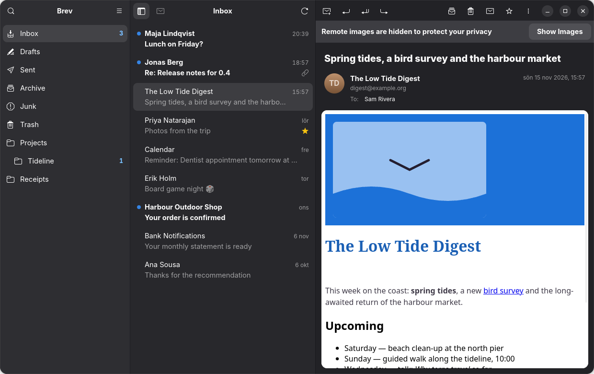
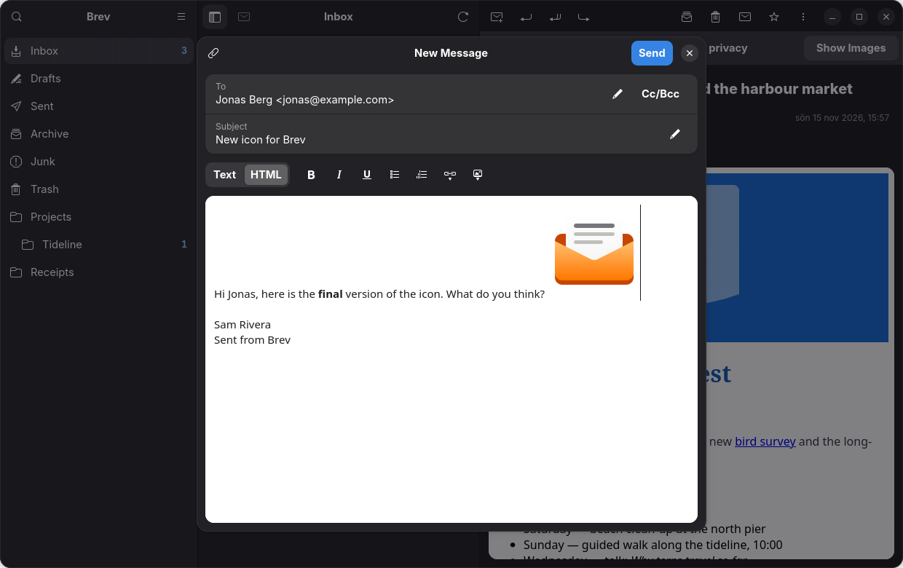
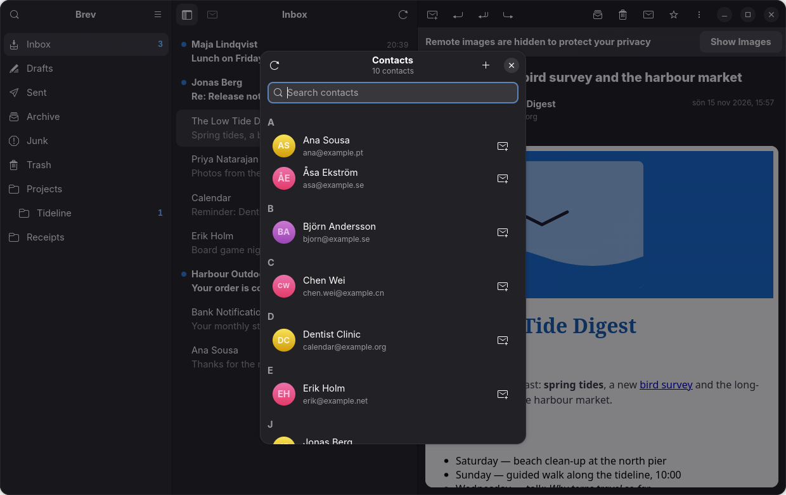
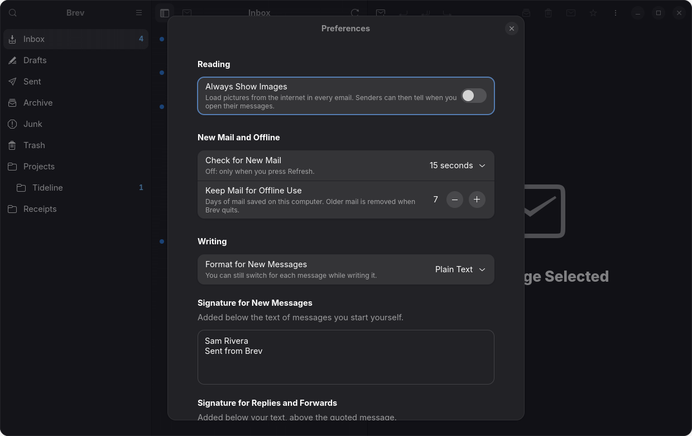

# Brev

**Email for GNOME. It reads mail and sends mail. That's the whole pitch.**

Brev (Swedish for "letter") is a mail client for GNOME that skips the account
wizard, the server settings, the calendar it was never asked to be and the
assistant that summarizes your aunt's emails. Your accounts already live in
**Settings → Online Accounts**; Brev just picks them up and gets on with it.

> [!NOTE]
> **Made with AI.** Brev was built in collaboration with
> [Claude Code](https://claude.com/claude-code), Anthropic's AI coding
> assistant. I came up with the ideas, tried every change on my own desktop and
> sent it back when it wasn't right; Claude wrote most of the code. If you'd
> rather keep your inbox free of AI-written code, no hard feelings, this is
> your exit sign. 👋



## Why Brev?

Mail clients tend to come in two flavours. There is the one that wants to be
your calendar, task list, chat app, RSS reader and part-time CRM, with a
settings window you could get lost in for a weekend. And there is webmail, which
wants to be all of that plus an advertising platform.

Brev is the third flavour: an email client. It opens, it shows your mail, it
lets you answer it. It looks and behaves like the rest of your GNOME desktop
because it is built from the same parts, and it trusts GNOME to do the things
GNOME already does well.

It is deliberately **lean**:

- **No account setup.** You already signed in, in Settings. Brev reads your
  accounts from GNOME Online Accounts, OAuth and all, and never sees or stores
  a password. Add an account there and it simply shows up here.
- **No server fields.** No IMAP port, no SMTP port, no "SSL/TLS or STARTTLS?".
  Online Accounts knows. Brev asks Online Accounts.
- **No tracking pixels.** Pictures from the internet stay blocked until you say
  otherwise, so senders can't see when you open their newsletters.
- **No gossip in your notifications.** "2 new emails have arrived." Not who,
  not what. Your lock screen is not a billboard.
- **No forty pages of settings.** One window, a handful of choices, sensible defaults.

## What you get

| You'd expect | In Brev |
|---|---|
| Your accounts | ✔ Straight from Settings → Online Accounts. Google, IMAP/SMTP, the lot |
| HTML mail that looks right | ✔ Rendered with WebKit in a sandbox: no scripts, no cookies, no trackers |
| Pictures when *you* want them | ✔ One click per email, and Brev remembers it |
| Writing in plain text or HTML | ✔ Bold, lists, links, and pictures pasted straight from the clipboard |
| Address suggestions as you type | ✔ From the contacts in your Online Accounts |
| Adding someone who just wrote to you | ✔ Click their name in the email, *Add to Contacts*. Done |
| Mail on the train | ✔ The last 7 days (or as many as you like) are kept for offline reading; replies wait in the Outbox |
| Knowing when something arrives | ✔ A quiet GNOME notification; the folder refreshes every 15 seconds, less often, or only when you ask |
| Only the stuff you haven't read | ✔ One button, and the list shows unread mail only |
| Fitting in | ✔ libadwaita, dark mode, your icon theme, and a layout that works down to phone size |
| A to-do list, a calendar and an AI butler | Not here. GNOME has apps for the first two. |

### Writing

Plain text or HTML, switchable per message. Bold, italic, lists and links are a
click away, screenshots paste straight in with <kbd>Ctrl</kbd>+<kbd>V</kbd>, and
everything goes out with a plain-text copy for people whose mail program
prefers it that way. Separate signatures for new mail and replies, if you're
into that.



### Contacts

Your contacts come from the same Online Accounts as your mail. They are
suggested while you type addresses, listed alphabetically, and editable right
in Brev. Changes go back to your account, so your phone sees them too. Brev only
touches the fields it shows: photos, birthdays and notes stay exactly as they
were, and a contact you changed on your phone in the meantime is never
overwritten.



### Preferences

All of them.



## Privacy, briefly

- Remote pictures are blocked by default; HTML mail runs without JavaScript in
  a private web view that keeps no cookies or storage.
- Links open in your browser, never inside Brev.
- Sign-in is handled by GNOME Online Accounts. Brev asks it for a token when it
  needs one and keeps nothing.
- Mail is cached on your own computer (`~/.cache/brev`) and trimmed whenever
  Brev quits, to the last 7 days or however many you set.
- New-mail notifications say how many emails arrived. That's all they say.

## Install

Brev is tested on GNOME 51 with libadwaita 1.10. You need Python 3, PyGObject,
GTK 4, libadwaita, the GNOME Online Accounts introspection data
(`gir1.2-goa-1.0`) and, for HTML mail, WebKitGTK 6:

```bash
sudo apt install gir1.2-webkit-6.0
```

Run it straight from the checkout:

```bash
./bin/brev
```

Or add it to your app grid (it still runs from this folder):

```bash
./install.sh
```

No accounts yet? Add one in **Settings → Online Accounts** with *Mail*
switched on. Just want a look first? `./bin/brev --demo` opens a pretend inbox
that never touches the network.

## Develop

| Path | What |
|---|---|
| `brev/accounts.py` | Reads mail accounts and credentials from GNOME Online Accounts |
| `brev/imap.py`, `brev/smtp.py` | IMAP and SMTP (XOAUTH2 or password) |
| `brev/cache.py`, `brev/offline.py` | The SQLite cache, offline mode, the Outbox and the 7-day trim |
| `brev/service.py` | One worker thread per account; results come back on the GTK main loop |
| `brev/message.py` | MIME parsing, HTML to text and back |
| `brev/html_view.py`, `brev/html_editor.py` | Sandboxed WebKit for reading and writing HTML |
| `brev/contacts.py` | CardDAV contacts: reading, careful vCard editing, conflict checks |
| `brev/window.py`, `widgets.py`, `compose.py`, … | The libadwaita UI |
| `brev/demo.py` | The pretend inbox behind `--demo` |

- `BREV_DEBUG=1` for verbose logging.
- `BREV_DEMO_OFFLINE=1 ./bin/brev --demo` starts the demo with its "server" down.
- Settings live in `~/.config/brev/settings.ini`, the cache in `~/.cache/brev/`.

## Not done yet

- No conversation threading. Every email stands on its own.
- New mail is checked on a timer (every 15 seconds by default) rather than pushed by the server (IMAP IDLE).
- Drafts are not saved. Closing an unsent message asks before throwing it away.
- One pair of signatures for all accounts.
- Pictures are sent at full size, so a phone photo makes a hefty email.
- Microsoft accounts don't offer contacts through Online Accounts.
- No Flatpak yet. Mostly tested with Gmail.

## License

GPL-3.0-or-later. See [LICENSE](LICENSE).
